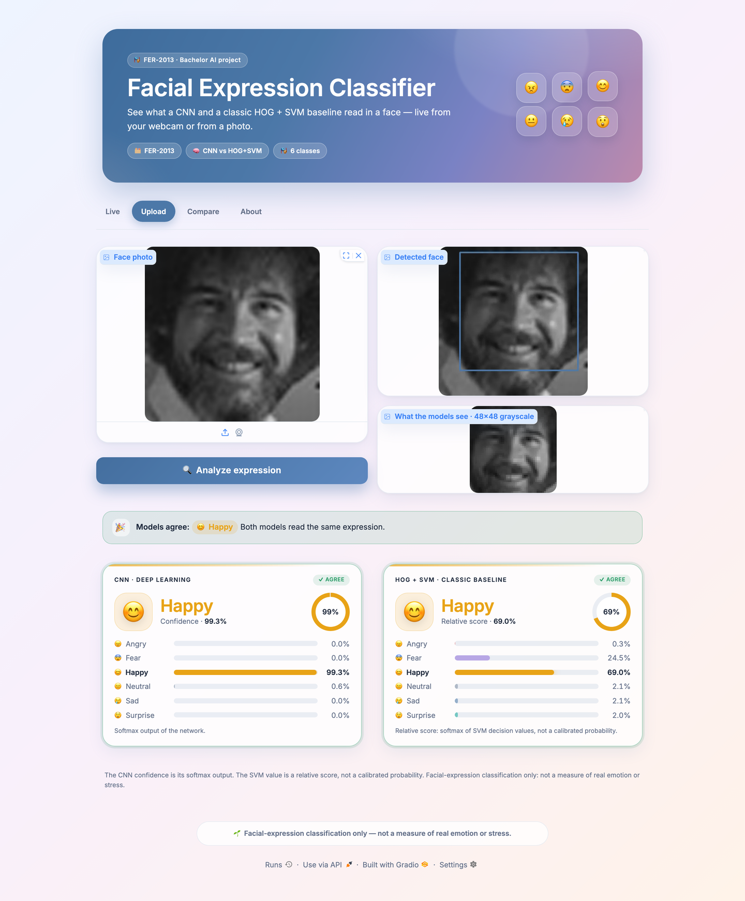
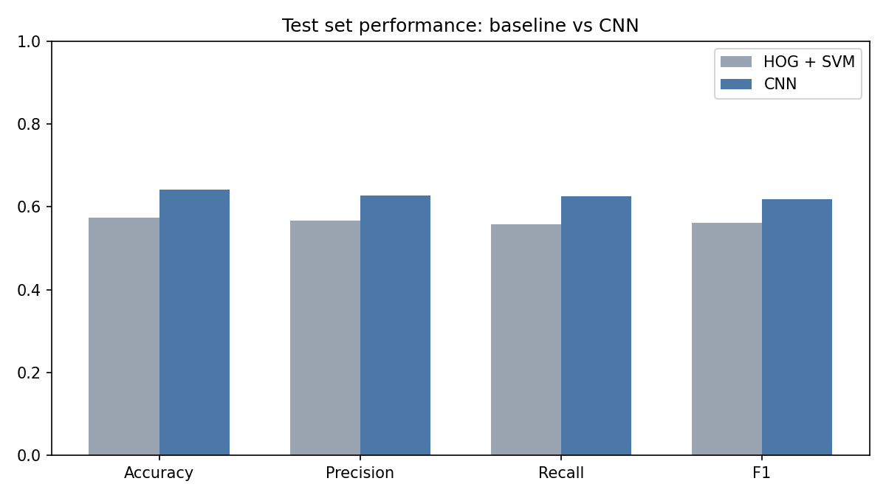
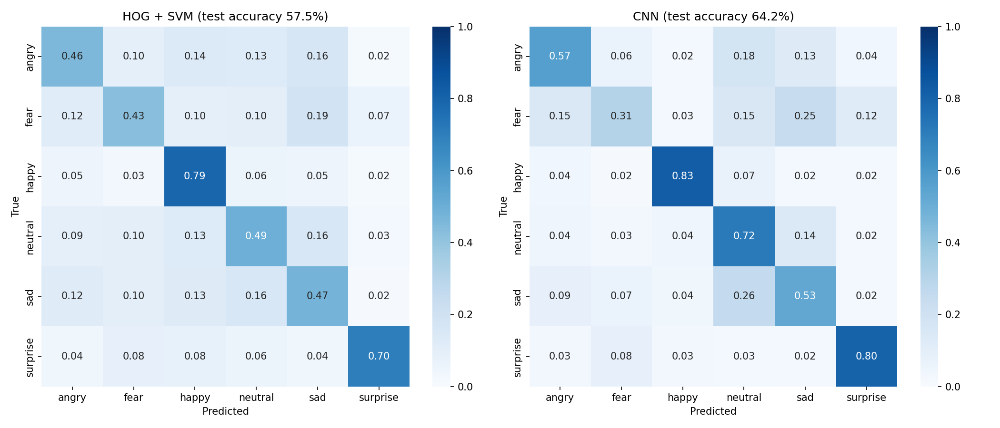
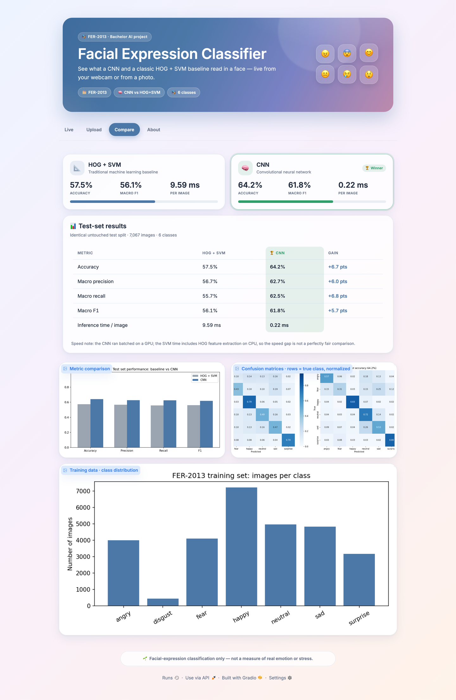

# Facial Expression Classifier

**CNN vs HOG + SVM on FER-2013 — live webcam and photo analysis with Gradio**


<p align="center">
  
</p>
<p align="center"><em>Upload tab: both models agree on "happy".</em></p>

> **Scope:** This project classifies **visible facial expressions** into six categories. It does **not** detect emotions, measure stress, or diagnose anything. The repository name reflects the original project idea; the app deliberately avoids those claims.

## Overview

A bachelor AI project that compares two very different approaches to facial-expression recognition on the same data:

- **HOG + SVM** — a classical computer-vision baseline using hand-crafted features.
- **CNN** — a convolutional neural network that learns features directly from pixels.

Both models are served in a single Gradio app. You can analyze a photo, stream predictions from a webcam, and see exactly where the two models agree or disagree.

The trained models are included, so the demo runs without retraining.

## Features

- **Live webcam analysis** — face detection, per-frame predictions, and smoothing over the last 7 frames.
- **Photo upload** — detects the largest face, crops it to 48×48 grayscale, and classifies it.
- **Side-by-side predictions** — CNN confidence and HOG + SVM relative scores for all six classes.
- **Agreement banner** — highlights when the two models read the same expression and explains when they differ.
- **Model comparison tab** — test metrics, comparison chart, confusion matrices, and class distribution.
- **Privacy-friendly** — images are processed in memory and are not stored by the app.
- **Graceful fallback** — if no face is detected, the whole image is used and a warning is shown.

## Results

Evaluated on the same untouched test split: **7,067 images**, **6 classes**.

| Metric | HOG + SVM | CNN |
|---|---:|---:|
| Accuracy | 57.5% | **64.2%** |
| Macro precision | 56.7% | **62.7%** |
| Macro recall | 55.7% | **62.5%** |
| Macro F1 | 56.1% | **61.8%** |
| Inference time / image | 9.59 ms | **0.22 ms** |

> **Speed caveat:** the CNN ran batched on a GPU, while the SVM timing includes CPU HOG feature extraction. The speed gap is not a perfectly controlled comparison.

| Model comparison | Confusion matrices |
|:---:|:---:|
|  |  |

<details>
<summary>Compare tab screenshot</summary>



</details>

## How it works

1. **Face detection** — OpenCV's Haar cascade finds faces in the frame.
2. **Preprocessing** — the largest face is cropped and resized to 48×48 grayscale. If no face is found, the full image is used.
3. **CNN prediction** — a 4-block convolutional network produces a softmax distribution over the six classes.
4. **HOG + SVM prediction** — HOG features are extracted and passed through a standardized PCA + RBF SVM pipeline. The displayed SVM value is a relative score, not a calibrated probability.
5. **Live mode** — detection runs on a downscaled copy of the frame for speed, the CNN is called directly, and predictions are averaged over the last 7 frames.

### Models

| | HOG + SVM | CNN |
|---|---|---|
| Approach | Classical baseline | Deep learning |
| Input features | HOG: 9 orientations, 6×6 cells, 2×2 blocks, L2-Hys | Raw 48×48 pixels |
| Pipeline | Standardize → PCA (200) → RBF SVM | 4 conv blocks with BatchNorm and Dropout |
| Training | RBF SVM with balanced class weights | Augmentation, class weights, ~1.2M parameters, 60 epochs |
| Strength | Fast to train, interpretable features | Higher accuracy, learns patterns automatically |

## Dataset

[FER-2013](https://www.kaggle.com/datasets/msambare/fer2013) — 48×48 grayscale face images labeled with six expressions: **angry, fear, happy, neutral, sad, surprise**.

- The `disgust` class was removed because it contains only 436 training images.
- The dataset is imbalanced: `happy` is the largest class, while `fear` is the hardest to classify.
- The training/validation/test split used by this project is stored in `data/fer6.npz`.

## Tech stack

- **TensorFlow / Keras** — CNN training and inference
- **scikit-learn** — SVM pipeline and evaluation metrics
- **scikit-image** — HOG feature extraction
- **OpenCV** — Haar cascade face detection and image processing
- **Gradio** — interactive web interface
- **NumPy / joblib** — array operations and model serialization

## Project structure

```text
Emotion-Stress-Detector-AI/
├── app/
│   ├── app.py              # Gradio interface
│   ├── core.py             # face detection + model inference
│   ├── styles.py           # theme and CSS
│   ├── cnn_best.keras      # trained CNN used by the app
│   ├── svm_hog.joblib      # trained HOG + SVM pipeline used by the app
│   └── test_metrics.json   # metrics shown in the Compare tab
├── data/
│   └── fer6.npz            # FER-2013 split used for training and evaluation
├── models/
│   ├── cnn_best.keras
│   ├── cnn_final.keras
│   └── svm_hog.joblib
├── results/                # charts, confusion matrices, timing and metrics
├── assets/                 # README screenshots
├── requirements.txt
└── README.md
```

## Getting started

### Prerequisites

- Python 3.13 (tested)
- A webcam is optional — the Upload tab works without one
- No GPU is required to run the app

### Installation

From the project root:

```bash
python3 -m venv venv
source venv/bin/activate        # Windows: venv\Scripts\activate

pip install -r requirements.txt
playwright install chromium     # optional: only needed for browser automation
```

`requirements.txt` captures the environment used locally, including Playwright. Playwright is not required to run the app itself.

### Run

```bash
python app/app.py
```

Open **http://127.0.0.1:7860** in your browser.

> The app loads `app/cnn_best.keras` and `app/svm_hog.joblib`. Keep the `app/` folder intact when running it.

## Using the app

- **Live** — allow camera access once and predictions stream in automatically. The status bar shows FPS, face detection, and inference time.
- **Upload** — drop a face photo, or take a snapshot, then press **Analyze expression**.
- **Compare** — view the test-set metrics, model comparison chart, and confusion matrices.
- **About** — read the method, limitations, and privacy notes.

## Limitations and responsible use

- **This is facial-expression classification, not emotion or stress detection.** A facial appearance does not reliably reveal what a person feels, and it cannot measure stress or diagnose anything.
- **Labels are noisy.** FER-2013 labels were crowd-sourced, and humans agree with them only about 65–70% of the time.
- **Accuracy is limited.** The CNN reaches about 64% on six classes. `fear` is the weakest class and is often confused with sad, angry, or surprise.
- **Bias risk.** Performance may differ across ages, skin tones, lighting conditions, and cultures. Posed expressions also differ from natural ones.
- **Not for decisions.** Do not use this project for hiring, grading, surveillance, health, or any decision about a person.
- **Privacy.** Images are processed in memory to produce a prediction and are not stored by the app. Live frames are processed one at a time and are not saved.

## Acknowledgements

- FER-2013 for the dataset
- TensorFlow, scikit-learn, scikit-image, OpenCV, and Gradio for the open-source tooling
- The Gradio team for the interface components used in this app

---

Built as a bachelor AI project. Educational use only.
